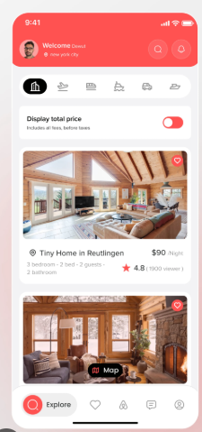
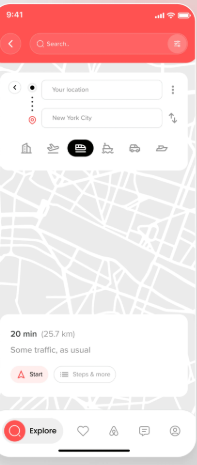
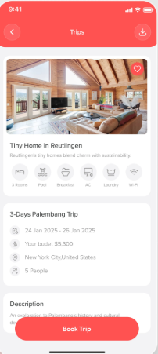

# Airbnb clone

Clon de una interfaz de alojamientos inspirada en Airbnb, creado como proyecto de práctica con páginas de inicio, búsqueda y detalle. Incluye datos mock y una API simulada.

## Capturas

| Inicio | Catálogo | Detalle |
|---|---|---|
|  |  |  |

## Stack

- Next.js 16 con App Router
- React 19
- TypeScript
- Tailwind CSS 4

## Rutas

- `/` — Inicio con categorías y alojamientos.
- `/search` — Catálogo con búsqueda, filtros por categoría y orden.
- `/rooms/[id]` — Detalle de un alojamiento.

## Estructura

```text
app/                 Rutas y estilos globales
components/          Componentes reutilizables de interfaz
data/listings.ts     Fuente única de alojamientos y categorías mock
lib/                 API simulada y utilidades de formato
types/               Tipos de TypeScript
docs/screenshots/    Capturas de referencia
context.md           Especificación y contexto del proyecto
```

## Ejecutar en local

```bash
npm install
npm run dev
```

Abre [http://localhost:3000](http://localhost:3000) en el navegador.

Consulta la [especificación completa en context.md](context.md).
